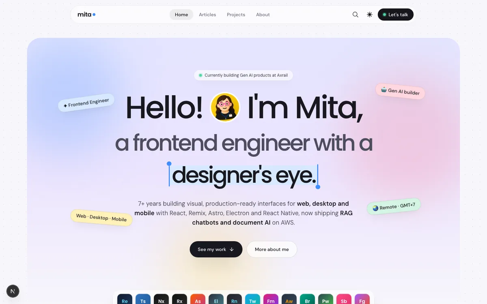
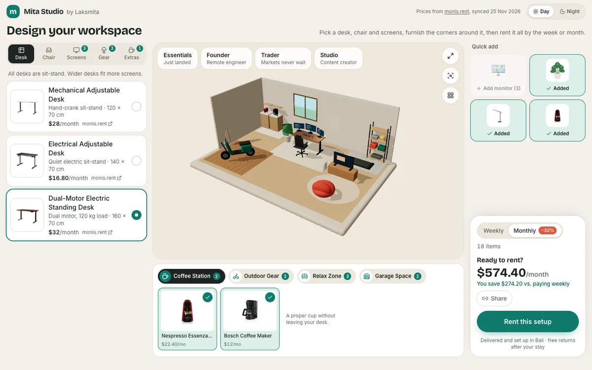
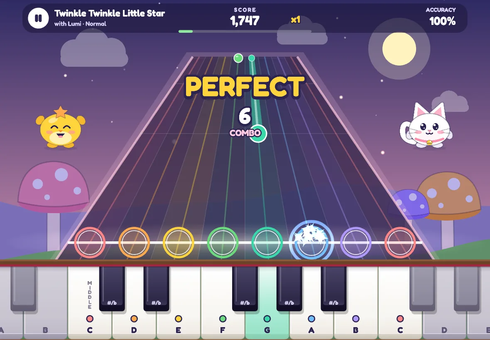
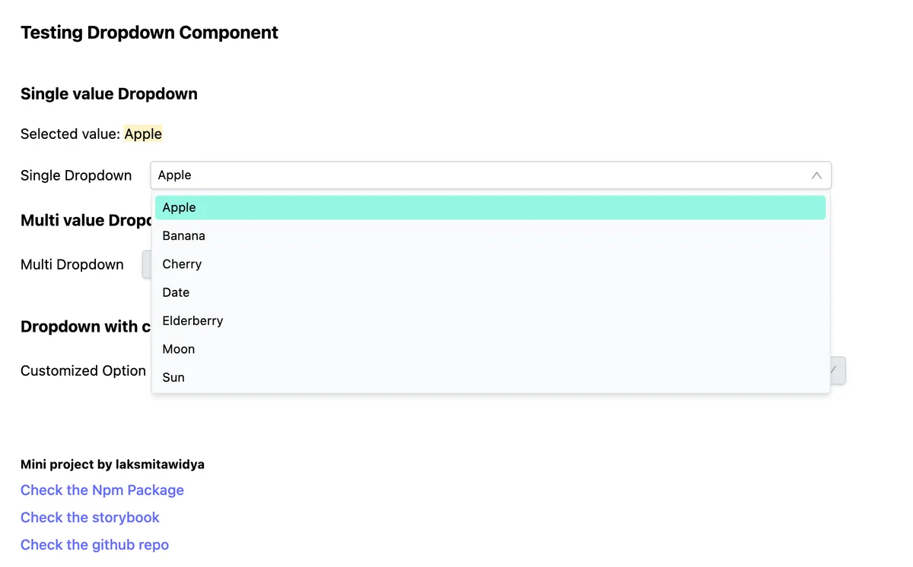
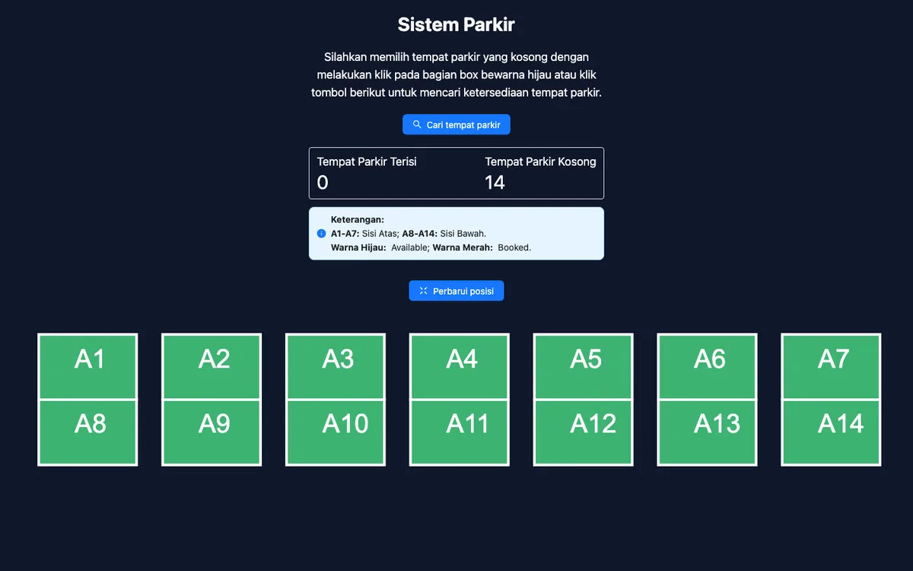
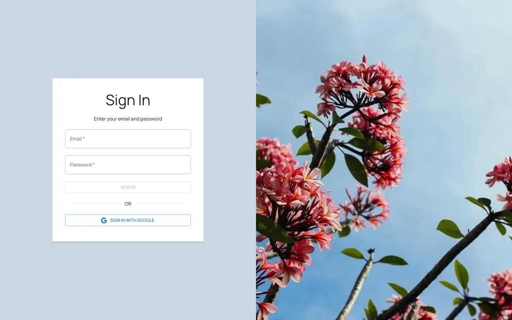

<div align="center">

# mita<span>.</span>

### Hello! I'm Mita, a frontend engineer who loves pixel-perfect details.

The portfolio and blog of **Laksmita Widya Astuti**: 7+ years building visual, production-ready interfaces for web, desktop and mobile, now shipping Gen AI products on AWS.

[**laksmita.space**](https://laksmita.space) · [Articles](https://laksmita.space/blog) · [Projects](https://laksmita.space/projects) · [LinkedIn](https://www.linkedin.com/in/laksmita-widya-astuti-4a392010b) · [Say hi](mailto:mithawid@gmail.com)




</div>

---

## ✦ The idea

The site is designed like a **design-tool canvas**: an off-white artboard with a dot grid, pastel accents, and the small UI details from design tools and operating systems that I love. It's playful in the details and professional where it matters.

| Motif | Where you'll find it |
| --- | --- |
| 🟦 **Selection frames** | Figma-style blue frames with corner handles and a layer label, drawn in on scroll |
| ✍️ **Text-selection highlights** | Words get "selected" like on a phone: a highlight sweeps across, then the drag handles pop in |
| 🖱️ **Custom cursor** | A dot plus a soft trailing ring that turns into a button reading `Open ↗`, `Read`, `Code` or `Drag · Open` over cards |
| 🗂️ **Tactile UI** | Sticky notes with folded corners, washi tape, macOS folders you can drag around, case-file tabs |
| 🍰 **Layered design** | Browser windows with sticky notes overlapping them, cards that pile up as you scroll, icon tiles peeking off edges |
| 🧰 **Tool dock** | My stack as real logo app icons in a macOS-style dock that magnifies under the pointer |

## ✦ Motion

All motion uses [Framer Motion](https://motion.dev) and **respects `prefers-reduced-motion`** through a global `MotionConfig`. The custom cursor only appears for mouse users who haven't turned on reduced motion.

- **Blur-in type**: headlines rise word by word out of a soft blur
- **Scroll-stacking cards**: work highlights pin and scale back as the next card slides over them
- **Mouse parallax**: hero tags drift at different depths as the pointer moves
- **Magnetic buttons**: calls to action lean toward the cursor
- **3D holo card**: the certification card tilts toward the pointer with a holographic sheen
- **Draggable desktop**: folders around my photo can be dragged, and a click still opens them
- **Shared-layout pills**: the nav highlight and project filters glide between options
- **Scroll progress bar**, an **animated count-up** for stats, a **circle-reveal mobile menu** and a **first-visit intro**

## ✦ Side projects featured on the site

| | Project | What it is | Built with |
| --- | --- | --- | --- |
|  | **[Mita Studio](https://mita-studio-theta.vercel.app)** · [code](https://github.com/laksmitawidya/mita-studio) | Design a Bali remote-work setup in a live 3D villa room, then rent it | Next.js 16, three.js, R3F, Tailwind 4 |
|  | **[Hazel Piano Pals](https://hazel-piano-pals.vercel.app)** · [code](https://github.com/laksmitawidya/piano-game) | A cozy piano rhythm game for kids, with all art and sound generated in code | Phaser 3, React, Vite, Web Audio |
|  | **[@laksmitawidya/dropdown](https://laksmita-dropdown-demo-wheat.vercel.app)** · [code](https://github.com/laksmitawidya/laksmita-dropdown-demo) | A lightweight React dropdown library published on npm | React, TypeScript, Tailwind, Storybook |
|  | **[Park System](https://park-system.vercel.app)** · [code](https://github.com/laksmitawidya/park-system) | An interactive, canvas-drawn parking-lot map for finding free bays | React, Konva, TypeScript, Ant Design |
|  | **[Next Mini Portfolio](https://next-mini-project.vercel.app)** · [code](https://github.com/laksmitawidya/next-mini-project) | An App Router starter with Google sign-in and global state | Next.js, NextAuth, Zustand, MUI v5 |
|  | **[This portfolio](https://laksmita.space)** · [code](https://github.com/laksmitawidya/laksmitawidya-revamp) | The site you're reading about | Next.js 15, Framer Motion, Contentlayer |

Side projects live in [`data/sideProjectsData.ts`](data/sideProjectsData.ts), client work in [`data/projectsData.ts`](data/projectsData.ts) and [`data/workHighlights.ts`](data/workHighlights.ts).

## ✦ Design tokens

| Token | Swatch | Used for |
| --- | --- | --- |
| `ink` |  | Text and primary buttons |
| `canvas` |  | Page background with a dot grid |
| `sky` |   | Selection blue, links, focus |
| `lilac` |   | Hero and footer panels |
| `rose` |   | Accents and notes |
| `butter` |   | Sticky notes and highlights |
| `mint` |   | Status dots and notes |

Type is **Poppins** for display, **DM Sans** for reading and **Plus Jakarta Sans** for sticky notes and labels. Logos in the tool dock come from [Simple Icons](https://simpleicons.org) (CC0). Tokens live in [`tailwind.config.js`](tailwind.config.js). Older class names (`cocoa`, `cream`, `coral`…) are mapped onto the new palette, so legacy MDX still renders in the new colours.

## ✦ Under the hood

- **Framework**: [Next.js 15](https://nextjs.org/) App Router, React 19, TypeScript
- **Styling**: Tailwind CSS v3 with a custom token set and a few hand-written CSS primitives (sticky notes, tape, folders, holo sheen)
- **Motion**: Framer Motion
- **Content**: [Contentlayer2](https://github.com/timlrx/contentlayer2) + MDX with KaTeX, Prism highlighting and GitHub-style alerts
- **Extras**: KBar search, Giscus comments, Umami analytics, RSS feed and sitemap, light, dark and system themes

```
app/                  # App Router pages: home (Main.tsx), projects, about, blog, tags
components/
  ui/                 # Motion & canvas primitives: CustomCursor, Dock, StackCards,
                      # ProjectWindow, DesktopFolders, Selection, BlurText, HoloCard…
  Header.tsx          # Floating pill nav that hides on scroll down
  Footer.tsx          # "let's work together" sign-off with copy-email button
data/                 # Blog MDX, author bio, site metadata, project data
layouts/              # About and blog list layouts
public/static/images/ # Portraits and project screenshots
```

## ✦ How it was built

Honestly: this site was largely vibe-coded with AI (Kiro and Claude), then reviewed, tested on real devices and tuned by hand. That's how I like to work now: hand-written code where it matters, AI where it speeds things up, and a human owning what ships.

## ✦ Run it locally

Requires the Node.js version in [`.nvmrc`](.nvmrc).

```bash
npm install
npm run dev          # http://localhost:3000
npm run build && npm start
npm run clear-cache  # reset the Contentlayer cache
```

Copy `.env.example` to `.env.local` for the optional integrations:

| Variable | Description |
| --- | --- |
| `NEXT_PUBLIC_GISCUS_REPO` | GitHub repo used by Giscus for comments |
| `NEXT_PUBLIC_GISCUS_REPOSITORY_ID` | Giscus repository ID |
| `NEXT_PUBLIC_GISCUS_CATEGORY` | Giscus discussion category |
| `NEXT_PUBLIC_GISCUS_CATEGORY_ID` | Giscus category ID |
| `NEXT_UMAMI_ID` | Umami analytics website ID |
| `BASE_PATH` | Base path when deploying to a subdirectory |

### Deploy

Deployed on **[Netlify](https://www.netlify.com/)**: every push to `master` builds and ships. A `Dockerfile` is included for self-hosting:

```bash
docker build -t laksmitawidya-portfolio .
docker run -p 3000:3000 laksmitawidya-portfolio
```

## ✦ Thanks

This site started from the [Tailwind Nextjs Starter Blog](https://github.com/timlrx/tailwind-nextjs-starter-blog) by Timothy Lin ([@timlrx](https://github.com/timlrx)). Thank you for building and sharing it!

<div align="center">

[MIT](./LICENSE) · Made with ♥ (and a lot of springs) by Mita

</div>
